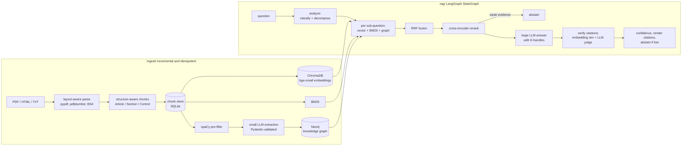

# PolicyLens

**A hybrid GraphRAG assistant for policy and compliance documents.** Ask a question such as *"Under India's DPDP Act, what must a company do after a personal data breach, and how does that compare with GDPR?"*. PolicyLens works through these steps:

1. splits the question into sub-questions;
2. retrieves evidence with a **knowledge graph, vector search and BM25**;
3. reranks the evidence with a local cross-encoder;
4. writes an answer where **every factual sentence cites a specific source chunk**;
5. **checks those citations** and removes sentences their sources don't support;
6. reports a confidence score, and says *"I don't have enough evidence"* instead of guessing.

The project runs entirely on free tiers: Groq for the LLM, NVIDIA NIM as a fallback, and local CPU models for embeddings and reranking. It runs on an 8 GB laptop with no GPU.

Corpus: India's **DPDP Act 2023**, **GDPR**, **NIST CSF 2.0** and **NIST SP 800-53 Rev. 5** (about 1,000 chunks). You can add any PDF, HTML or TXT file.

---

## Architecture



| Layer | What it does | Key file |
|---|---|---|
| LLM client | Disk cache keyed by a hash of the prompt. Exponential backoff on 429, honouring `Retry-After`. Daily token budget per provider and model. Falls back from Groq to NVIDIA, then to a clear error. | [core/llm.py](core/llm.py) |
| Parsing | Gazette PDFs are split into body and margin columns, because DPDP section titles are printed as margin notes. The penalty Schedule is rebuilt row by row. Running headers are removed from other PDFs. | [ingest/parse.py](ingest/parse.py) |
| Chunking | Splits on Articles, Sections, controls (`AC-2`) and CSF categories (`GV.OC`) first, then into windows of at most 700 tokens with an 80-token overlap. IDs are stable and readable, such as `gdpr::article-33::0`. | [ingest/chunk.py](ingest/chunk.py) |
| Knowledge graph | Covered below under *Knowledge graph model*. | [ingest/kg.py](ingest/kg.py), [ingest/graph.py](ingest/graph.py) |
| Retrieval | Vector top-k, BM25 top-k, and graph top-k. The graph step matches nodes by full-text search, then walks up to 2 hops and never passes through a Regulation node, which links to everything. The three lists are fused with RRF and then reranked. | [rag/retrieve.py](rag/retrieve.py) |
| Answer and verification | The model cites `[E2]`-style handles and code maps them to `[doc, section, chunk_id]`, so the model can't invent a chunk ID. Each cited sentence is checked by embedding similarity and by the small LLM acting as a judge. | [rag/answer.py](rag/answer.py) |
| Pipeline | A LangGraph `StateGraph` with a conditional edge to abstain. `PipelineConfig` switches parts on and off for the evals. | [rag/pipeline.py](rag/pipeline.py) |
| API and UI | FastAPI with `/ask` (SSE), `/ingest`, `/health` and `/stats`. Streamlit chat with clickable citations, a confidence badge, a "How I found this" panel and a pyvis graph view. | [api/main.py](api/main.py), [ui/app.py](ui/app.py) |

### Knowledge graph model

| Edge | How it's made |
|---|---|
| `Regulation -CONTAINS-> Section` | deterministic |
| `Section -REQUIRES-> Obligation`, `-DEFINES-> Definition`, `-CONTAINS-> Right / Penalty` | deterministic, from the chunk's own section |
| `Section -REFERENCES-> Section` | regex on "Article 55", "section 8", "AC-3", "GV.OC" |
| `Obligation / Right -APPLIES_TO-> Entity`, `Penalty -PENALIZES-> ...`, `Definition -DEFINES-> Entity`, `Obligation -REQUIRES-> Obligation` | small LLM, schema-checked, invalid triples dropped |
| `x -SIMILAR_TO- y` across regulations | local embedding similarity of name and description, plus seed pairs (Data Fiduciary ≈ Controller, Data Principal ≈ Data Subject, …) |
| `every node -MENTIONED_IN-> Chunk` | provenance, which makes graph hits citable |

Duplicate entities are merged by normalized name ("The Data Fiduciaries" → `data fiduciary`). Entities are shared across regulations. Obligations, rights, penalties and definitions are scoped to their own regulation. Every relationship records the chunk IDs that produced it, so a changed chunk can be removed from the graph and extracted again.

---

## Quick start

You need Python 3.12, [uv](https://docs.astral.sh/uv/) and Docker. All of it is free.

```bash
# 1. install
uv sync

# 2. keys: create free ones at console.groq.com/keys (and optionally build.nvidia.com)
cp .env.example .env            # then paste GROQ_API_KEY=...
uv run python -m scripts.check_models   # checks the model IDs in .env against /models

# 3. Neo4j (capped at 1 GB RAM)
docker compose up -d neo4j

# 4. corpus + ingestion (embedding ~6 min on CPU; graph extraction spends Groq tokens, see below)
uv run python -m scripts.download_corpus
uv run python -m ingest.pipeline                # or --no-graph for zero LLM calls

# 5. run
uv run uvicorn api.main:app --port 8000
uv run streamlit run ui/app.py                  # http://localhost:8501
```

Without any key, ingestion, vector and BM25 search, reranking and the structural graph all still work. Answering then abstains with a clear message.

### API

```bash
curl -N -X POST localhost:8000/ask -H "content-type: application/json" \
     -d '{"question": "What is the DPDP penalty for failing to protect personal data?", "config": "full"}'
```

`/ask` streams an `event: stage` after each pipeline step, then an `event: result` with the answer, citations, confidence, per-sentence verification and the retrieval trace. `/ask/sync` returns the same result as plain JSON.

---

## Staying inside free tiers

| Mechanism | Where |
|---|---|
| Every LLM call is cached in SQLite, keyed by a hash of the model, messages and parameters. Re-running ingestion or evals costs 0 tokens. | `core/store.py` |
| Daily token ledger per `provider:model`. Groq's free caps are per model, so the 70B and 8B models have separate budgets in `.env`. | `core/llm.py` |
| 429, 5xx and timeouts get exponential backoff with jitter. If `Retry-After` is over 30 s, the call falls back to the next provider instead of blocking. | `core/llm.py` |
| The spaCy pre-filter skips chunks with no normative language (12.5% of the corpus), so they never reach the LLM. | `ingest/kg.py` |
| Ingestion is incremental at two levels. Files with an unchanged SHA-256 and unchanged chunker code are skipped. Only chunks whose content hash changed are re-embedded or re-extracted. | `ingest/pipeline.py`, `ingest/store.py` |
| Graph extraction is resumable. When the budget runs out, the remaining chunks get their deterministic structure now and LLM extraction on the next run. `--kg-limit N` caps calls per run. | `ingest/graph.py` |
| Questions whose best reranked chunk scores under 0.08 abstain before calling the large model. | `rag/pipeline.py` |

**Budget arithmetic.** Graph extraction takes 885 small-model calls at about 1.5k tokens each, roughly 1.3M tokens. That's about 3 days at Groq's 8B free cap, and it resumes automatically. One full-pipeline answer uses about 3k large-model tokens and about 4k small-model tokens. To focus extraction on the regulations first, run:

```bash
uv run python -m ingest.pipeline --kg-docs dpdp_act_2023,gdpr,nist_csf_2.0
```

## Low-RAM mode (8 GB laptops)

The defaults target a 7.3 GB Windows laptop:

- Neo4j has `mem_limit: 1g`, a 512 MB heap and a 256 MB page cache.
- The embedder and reranker are loaded once per process and run on CPU, with embedding batches of 16.
- The default reranker is `cross-encoder/ms-marco-MiniLM-L-6-v2`. Measured on this machine, it adds 0.5 GB of RAM and takes 0.7 s per query. `BAAI/bge-reranker-base` adds 1.6 GB and takes 4.5 s. Switch with `RERANK_MODEL` in `.env` if you have 16 GB.
- Ingestion streams: one document at a time, embedding batches of `INGEST_BATCH_SIZE` (64), and paged SQLite reads for the graph step and BM25. Peak ingestion RSS was 775 MB.

---

## Evaluation

`evals/gold.jsonl` holds **44 questions**: 16 simple, 10 multi-hop, 9 cross-regulation comparisons and 9 unanswerable. Each one lists its expected source sections, a reference answer and key facts. Every fact was checked against the indexed text.

```bash
uv run python -m evals.run                    # 3 configs x 44 questions, resumable
uv run python -m evals.run --out evals/results/<run>   # continue a run after a rate limit
```

| Metric | How it's computed |
|---|---|
| Recall@5, MRR | Expected sections among the top-5 evidence chunks, and the reciprocal rank of the first hit. No LLM. |
| Key-fact accuracy | Gold facts (e.g. "72 hours", "250 crore") found in the answer. Deterministic. |
| Citation precision | Share of the cited sentences shown to the user that the judge says their citation supports. |
| Faithfulness | Small model as judge: supported claims divided by total claims, given the evidence. Cached. |
| Abstention | Abstains on unanswerable questions and answers answerable ones. |
| Latency | p50 and p95 seconds, end to end. |

The three configurations compared:

- `vector`: plain vector RAG.
- `hybrid`: vector and BM25 with RRF.
- `full`: decomposition, vector, BM25 and graph, then reranking, verification and abstention.

### Results

**Retrieval run without an LLM key** (2026-11-06, CPU laptop, MiniLM reranker). Full results are in [evals/results/2026-11-06-retrieval-no-llm-v2/](evals/results/2026-11-06-retrieval-no-llm-v2/report.md).

| Metric (answerable questions) | vector | hybrid | full |
|---|---|---|---|
| Recall@5 | 0.76 | 0.80 | **0.88** |
| MRR | 0.75 | 0.70 | **0.82** |
| Recall@5, simple | 0.81 | 0.81 | **1.00** |
| Recall@5, multi-hop | 0.80 | **0.95** | 0.90 |
| Recall@5, comparison | **0.64** | 0.60 | **0.64** |
| Retrieval latency p50 / p95 (s) | 0.04 / 0.05 | 0.05 / 0.05 | 2.1 / 3.4 |

In this run:

- **No key was configured, so every answer abstained.** That's why key-fact accuracy, citation precision and faithfulness are empty, and why abstention accuracy reads 0.20. Add `GROQ_API_KEY` and run `python -m evals.run` to fill those in. The LLM cache makes later runs free.
- **The full config's query analysis fell back to keyword rules.** Comparisons were split per regulation, but each sub-question is just the original question plus "(only the part about X)". That is the main reason comparison recall doesn't beat the baselines here. The LLM analyzer writes self-contained sub-questions instead.
- **All 9 unanswerable questions scored a confidence of 0.34 or lower.** That's below the abstention threshold, so they would abstain even with a key.
- **Latency covers retrieval only.** The full config's 2 s is the cross-encoder reranking 20 candidates on CPU. Generation adds the Groq round trip.

**What the first run taught us.** [evals/results/2026-11-06-retrieval-no-llm/](evals/results/2026-11-06-retrieval-no-llm/report.md) had full-config Recall@5 at 0.81 and MRR at 0.79. Inspecting the misses led to three fixes:

1. **Named provisions.** "What does CP-9 require?" missed CP-9, because the ID appears in dozens of "Related Controls" lists. An exact-reference retriever now always includes provisions the question names.
2. **Sub-question ordering.** Evidence for comparisons was concatenated by sub-question, which buried the GDPR side below the top 5. It's now interleaved.
3. **Definition lists.** About 25 definitions per 700-token chunk diluted each one's embedding. Definitions units now use 250-token windows.

---

## Tests

```bash
uv run pytest            # 56 offline tests: fake LLM, fake models, no network, no Neo4j needed
```

The tests cover:

- **LLM client:** caching, backoff, fallback, budgets and JSON repair.
- **Parsing and chunking:** Gazette margin notes, running headers, GDPR recitals, CSF categories, token caps and stable IDs.
- **Incremental store:** paging and batched embedding.
- **Graph:** triple validation, references, and a resumable extraction loop.
- **Pipeline:** the full LangGraph flow with fakes, covering comparison, abstention and the baselines.
- **API:** SSE contract and validation.
- **Evals:** metric functions.

## Repo layout

```
core/      settings, LLM client (cache, backoff, budgets, fallback), local models
ingest/    parse -> chunk -> store -> Chroma + BM25 + Neo4j graph
rag/       analyze, retrieve (RRF + rerank), answer + verify, LangGraph pipeline
api/       FastAPI service
ui/        Streamlit app
evals/     gold set, metrics, runner, report
scripts/   corpus download, model check
docs/      project brief and phase plan
```

## Limitations

- **Graph extraction needs a Groq key and about 3 days of free-tier tokens for the whole corpus.** Until then the graph holds only structure: sections, cross-references and provenance. Graph retrieval still uses that structure.
- The DPDP Act often says "in such form and manner as may be prescribed" (for example the breach-notification deadline). Those details are in the DPDP Rules, which are not in the corpus, so the system correctly says the Act sets no deadline.
- The Gazette parser is tuned to Gazette of India layout, using margin columns and the Schedule table. Other PDFs use the generic parser.
- The heading rules for 800-53 can match an example control quoted in the narrative. In that case the real control gets a suffixed ID (`au-4-2`), but its citation label stays `AU-4`.
- Latency is CPU-bound (reranking and embeddings) and depends on the LLM cache. Cached questions are much faster than first runs.
